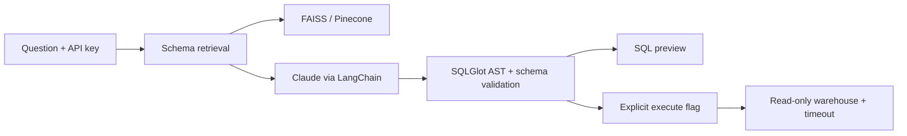

# SQL RAG Analytics Pipeline

Turn business questions into validated, read-only SQL. A FastAPI service retrieves relevant table schemas with FAISS or Pinecone, asks Claude through LangChain for structured SQL, validates the SQL AST and column references, and optionally executes it in SQLite or Snowflake.

**Status:** runnable portfolio implementation with deterministic local examples. External providers require your credentials. The résumé's “60% fewer hallucinated column references” has **not** been established; `evaluate.py` measures paired validation failures without inventing a result.

## Architecture



## Run locally

Requires Python 3.11. Run commands from this repository root.

```bash
python -m venv .venv
# Windows: .venv\Scripts\Activate.ps1
# macOS/Linux: source .venv/bin/activate
pip install -r requirements.txt
```

Copy `.env.example` to `.env` and replace `API_KEY`. Start the API:

```bash
uvicorn app.main:app --reload
```

Open [interactive API docs](http://localhost:8000/docs). POST `/query` with the `X-API-Key` header:

```json
{"question":"revenue by region","execute":true}
```

Local mode supports three exact questions: `total revenue`, `revenue by region`, and `customer count`. It uses synthetic data and hashed lexical vectors, not an LLM or semantic model. Completed sample revenue is **445.0**. Omitting `execute` returns only the SQL preview. The API fails closed when no API key is configured.

## Enable the full stack

1. Set `LLM_PROVIDER=anthropic`, `ANTHROPIC_API_KEY`, and `ANTHROPIC_MODEL` to a Claude model available to your account.
2. Set `EMBEDDING_BACKEND=sentence-transformers` for semantic retrieval. The initial run downloads the configured model; FAISS stays local.
3. Optionally set `VECTOR_BACKEND=pinecone`, `PINECONE_API_KEY`, and `PINECONE_INDEX_HOST`. Create a **384-dimensional cosine** index for the default embedding model. The namespace fingerprints both schema and embedding configuration. Upserts may take a short time to become searchable.
4. For Snowflake, set `WAREHOUSE=snowflake` and all `SNOWFLAKE_*` fields. Replace `schema.json` with the exact approved tables and types in the configured database/schema. Tables must use unqualified names; the connection fixes the database and schema.
5. Give the Snowflake role only warehouse usage, database/schema usage and SELECT on approved tables. No write privileges, stored procedures, external functions, or broad future grants. Schema validation is defense in depth, **not** a substitute for warehouse permissions.

`schema.json` is an explicit reviewed catalog, rather than automatic access to every warehouse table. Add join descriptions to improve retrieval. Real warehouse data never goes into the vector store; schema descriptions do. Questions and selected schemas are sent to Claude when enabled.

## Guardrails and limits

- One SELECT/UNION statement; reject mutation, SELECT INTO, locking and recursive CTEs.
- Resolve tables and columns against the approved catalog, including CTE scopes.
- Reject cross-schema/database references and non-allowlisted functions/UDFs.
- Clamp results to 200 rows; constant limits only; offsets capped at 10,000.
- SQLite uses a read-only connection, query-only mode, and a three-second progress timeout.
- Snowflake uses a 15-second statement timeout and must have a least-privilege role.
- An execution flag separates preview from running a query. No automatic repair-and-execute loop.

Read-only queries can still consume warehouse resources. Configure warehouse spending limits and API rate limits before public deployment. The function allowlist is deliberately restrictive; extend it with tests when adding business needs. This single-tenant service does not implement per-user warehouse authorization.

## Tests and evaluation

```bash
pytest -q
python evaluate.py paired-results.jsonl
```

Evaluation input: one JSON object per line with `question`, `baseline_sql`, and `rag_sql`. Use the same held-out questions, schema, model settings and generation budget in both conditions. The evaluator reports total validation failures and relative reduction; it does not establish semantic correctness or separately classify every hallucination. Manually label unknown-column errors and compare executed results to known answers before making the specific 60% résumé claim.

Docker: `docker build -t sql-rag .`, then `docker run --env-file .env -p 8000:8000 sql-rag`. Mount `/app/data` if you want the local demo database persisted.

## References

- [LangChain Anthropic integration](https://reference.langchain.com/python/langchain-anthropic)
- [SQLGlot qualification implementation](https://github.com/tobymao/sqlglot/blob/main/sqlglot/optimizer/qualify.py)
- [Pinecone vector upserts](https://docs.pinecone.io/guides/index-data/upsert-data)
- [Snowflake Python connector](https://docs.snowflake.com/en/developer-guide/python-connector/python-connector-example)
